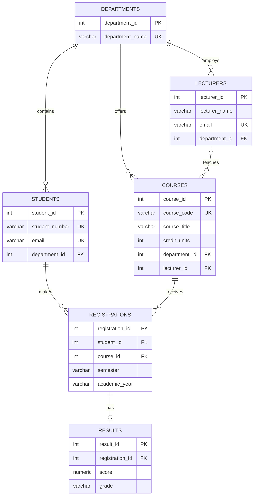

# Portfolio 1: Entity Relationship Diagram and Normalisation

## 1. Entity Relationship Diagram

The following ER diagram represents the relationships in the University Student Result Management System.

## 2. Relational Schema

- Departments(department_id, department_name)
- Students(student_id, student_number, first_name, last_name, email, department_id)
- Lecturers(lecturer_id, lecturer_name, email, department_id)
- Courses(course_id, course_code, course_title, credit_units, department_id, lecturer_id)
- Registrations(registration_id, student_id, course_id, semester, academic_year)
- Results(result_id, registration_id, score, grade)

PK = Primary Key; FK = Foreign Key; UK = Unique Key.

## 3. Normalisation

### First Normal Form (1NF)

Each table stores individual values in its columns. There are no repeating groups or lists of values within a single field.

### Second Normal Form (2NF)

Each table has a primary key, and its non-key attributes depend on the whole key. The registration table uses a unique registration identifier and prevents duplicate registrations for the same student, course, semester, and academic year.

### Third Normal Form (3NF)

Non-key attributes are stored with the entity they describe. For example, department names are stored in the Departments table rather than being repeated for every student or course. Foreign keys link the related entities.

The design aims to reduce unnecessary duplication and maintain data integrity.

## 4. Implementation Test Evidence

The database was tested using PostgreSQL 18 in a browser-based playground.

The schema creation completed successfully, creating six tables.

Sample data was inserted with the following expected record counts:

| Table | Records |
|---|---:|
| Departments | 2 |
| Students | 3 |
| Lecturers | 2 |
| Courses | 3 |
| Registrations | 4 |
| Results | 4 |

A JOIN query successfully returned four records containing student identifiers, student names, course details, examination scores, and grades.

Screenshots of the successful schema creation, record counts, and JOIN query results are retained as practical evidence.

## 5. Conclusion

The implementation demonstrates a relational database with primary keys, foreign keys, uniqueness rules, and check constraints. The design provides a foundation for query optimisation, transaction management, NoSQL modelling, and distributed database exercises.
