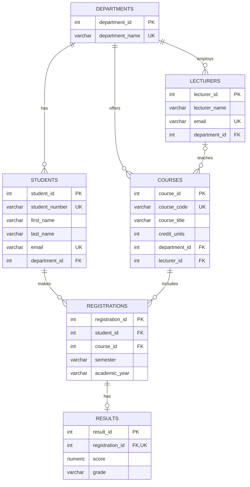

# Portfolio 1: Entity Relationship Diagram and Normalisation

## 1. Entity Relationship Diagram

The following Entity Relationship Diagram (ERD) represents the entities, attributes, and relationships in the University Student Result Management System. The diagram reflects the structure implemented in the PostgreSQL schema.

The ERD shows how the Departments, Students, Lecturers, Courses, Registrations, and Results entities are connected.

A department can have multiple students, lecturers, and courses. A lecturer may teach multiple courses, while a course may have no assigned lecturer or one assigned lecturer.

Students and courses have a many-to-many relationship that is resolved through the Registrations entity. Each registration can have zero or one associated result. The database enforces this relationship through a unique registration identifier in the Results table.

## 2. Relational Schema

The relational schema implemented in PostgreSQL is represented as follows:

- Departments(department_id, department_name)
- Students(student_id, student_number, first_name, last_name, email, department_id)
- Lecturers(lecturer_id, lecturer_name, email, department_id)
- Courses(course_id, course_code, course_title, credit_units, department_id, lecturer_id)
- Registrations(registration_id, student_id, course_id, semester, academic_year)
- Results(result_id, registration_id, score, grade)

**Key notation:**

- PK = Primary Key
- FK = Foreign Key
- UK = Unique Key

Primary keys uniquely identify records. Foreign keys establish relationships between tables and enforce referential integrity. Unique constraints prevent duplicate values or combinations of values where specified.

The Registrations table includes a composite unique constraint on student_id, course_id, semester, and academic_year. This prevents a student from registering for the same course more than once in the same semester and academic year.

The Results table has a unique constraint on registration_id, ensuring that each registration can have no more than one result.

## 3. Normalisation

### First Normal Form (1NF)

Each table stores individual values in its columns. There are no repeating groups or lists of values within a single field.

### Second Normal Form (2NF)

Each table has a primary key, and its non-key attributes depend on the whole key. The Registrations table uses a unique registration identifier. The composite unique constraint on student_id, course_id, semester, and academic_year also prevents duplicate registrations for the same student, course, semester, and academic year.

### Third Normal Form (3NF)

Non-key attributes are stored with the entity they describe. For example, department names are stored in the Departments table rather than being repeated for every student or course. Foreign keys link the related entities.

The design aims to reduce unnecessary duplication, avoid update anomalies, and maintain data integrity.

## 4. Implementation Test Evidence

The database was tested using PostgreSQL 18 in a browser-based playground.

The schema creation completed successfully, creating six tables.

Sample data was inserted with the following record counts:

| Table | Records |
|---|---:|
| Departments | 2 |
| Students | 3 |
| Lecturers | 2 |
| Courses | 3 |
| Registrations | 4 |
| Results | 4 |

A JOIN query successfully returned four records containing student identifiers, student names, course details, examination scores, and grades.

Screenshots of the successful schema creation, record counts, and JOIN query results are retained as practical evidence.

## 5. Conclusion

The implementation demonstrates a relational database with primary keys, foreign keys, uniqueness rules, and check constraints. The design provides a structured foundation for managing university academic records and supports the subsequent portfolio activities involving query optimisation, transaction management, NoSQL modelling, and distributed database exercises.
