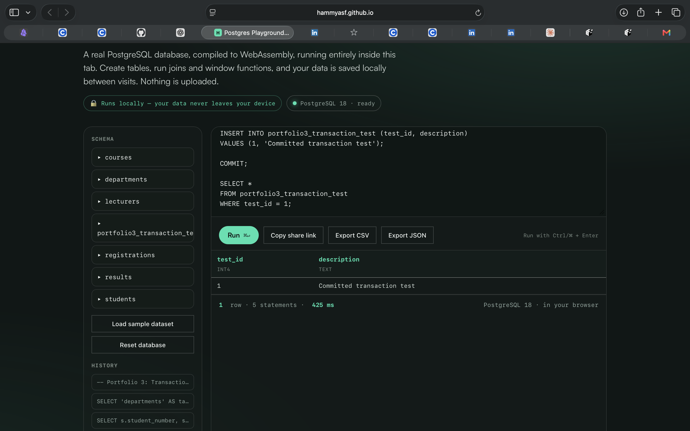
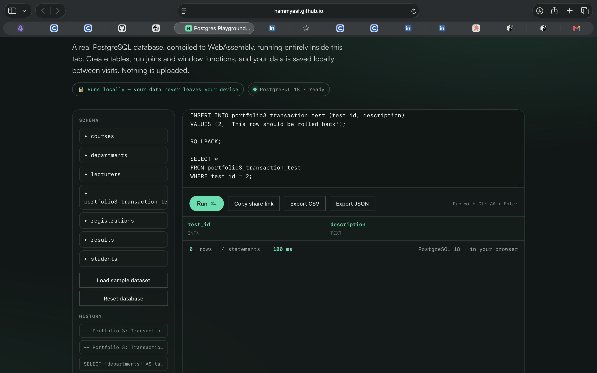
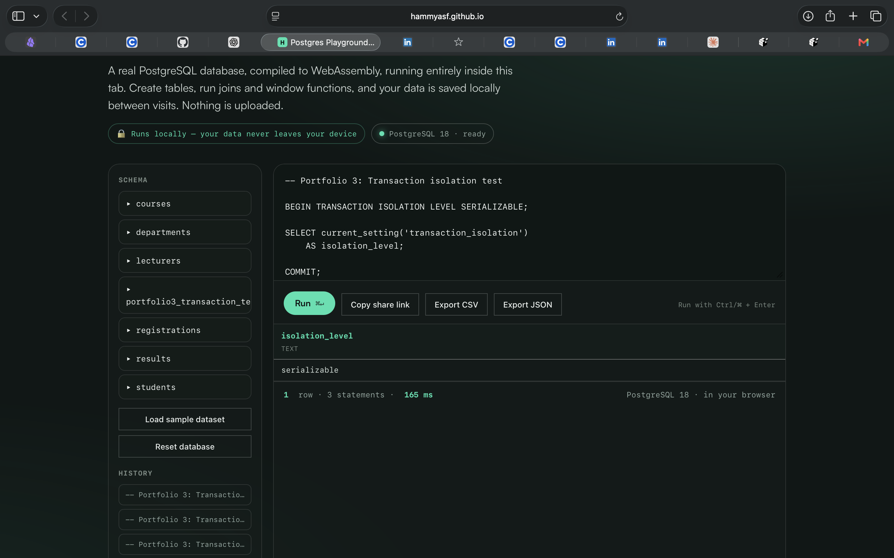
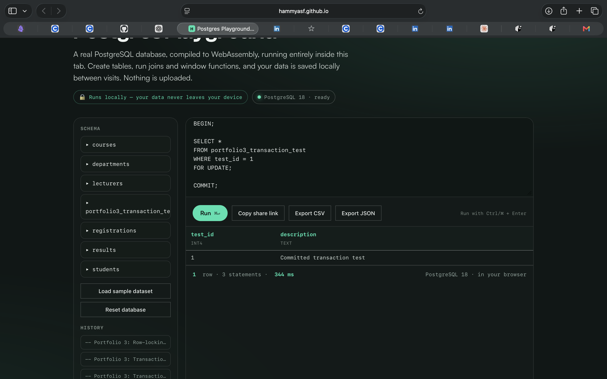

# Portfolio 3 Evidence

The following screenshots document the transaction and concurrency tests performed in PostgreSQL 18.

## 1. Commit Test

Demonstrates inserting a test row and committing the transaction.

## 2. Rollback Test

Demonstrates rolling back an insert and checking that the row is absent.

## 3. Isolation Test

Shows the configured transaction isolation level.

## 4. Row-Locking Test

Shows the `SELECT ... FOR UPDATE` demonstration.

