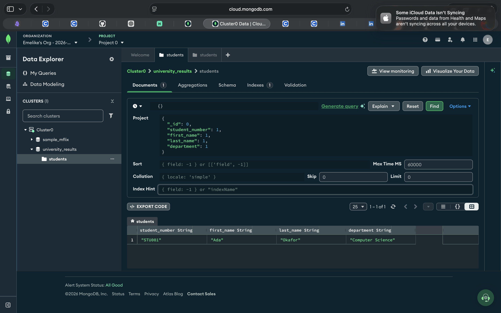
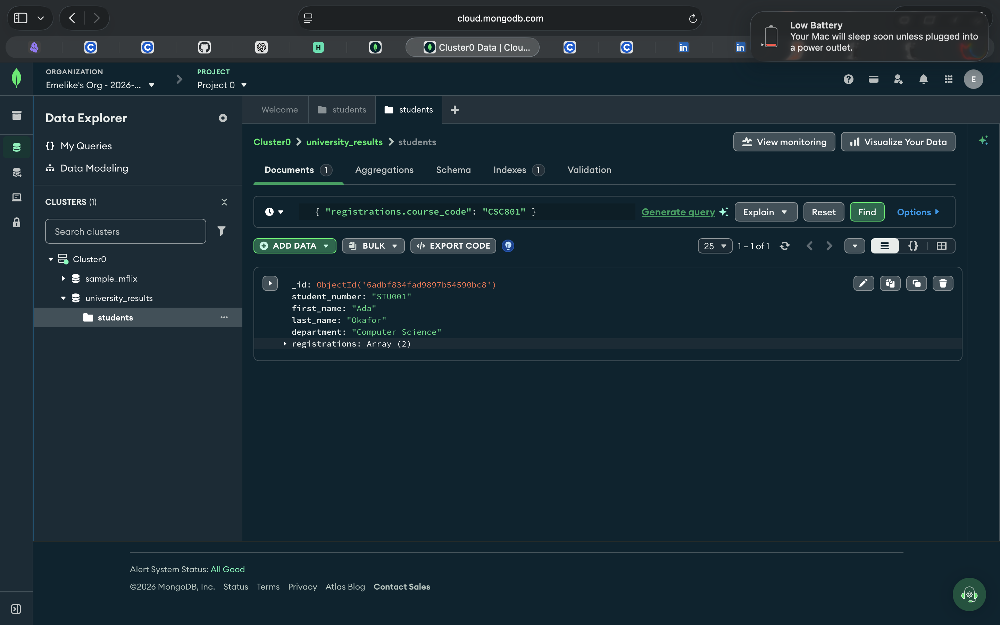

# Portfolio 4 Evidence

This folder contains screenshots of practical MongoDB queries performed in MongoDB Atlas Data Explorer for the University Student Result Management System.

## 1. Student Lookup

This screenshot shows the query filtering the `students` collection by `student_number` equal to `STU001`.

## 2. Embedded Score Query

This screenshot shows the query filtering documents where at least one embedded registration has a score greater than or equal to 80.

## Environment

- Database: `university_results`
- Collection: `students`
- Tool: MongoDB Atlas Data Explorer

## 3. Department Query

This screenshot documents a query on the `students` collection using a department-related filter. It provides evidence of filtering student records based on the department field.

## 4. Projection Query

This test used MongoDB Data Explorer's Project option to return selected fields from the student document. The output included the student number, first name, last name, and department while excluding the `_id` field. The result demonstrates how MongoDB projection controls which fields appear in query results.

## 5. Embedded Course Registration Query

This screenshot shows a query filtering the `students` collection by the embedded field `registrations.course_code` with the value `CSC801`. The query returned the student document for Ada Okafor, demonstrating how MongoDB can locate student records containing a registration for a specific course.

