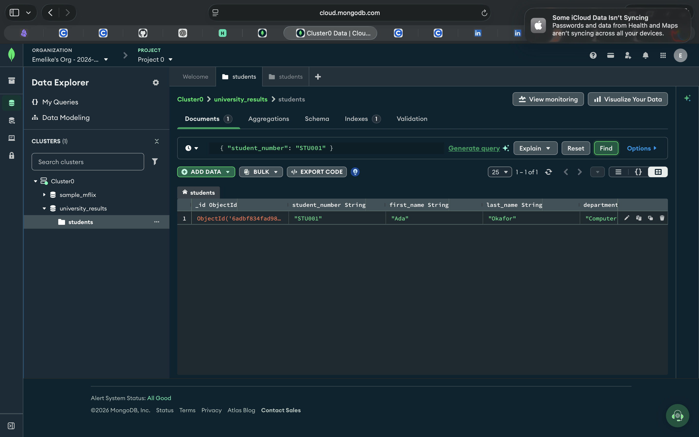

# Portfolio 4 Evidence

This folder contains screenshots of practical MongoDB queries performed in MongoDB Atlas Data Explorer for the University Student Result Management System.

## 1. Student Lookup

This screenshot shows the query filtering the `students` collection by `student_number` equal to `STU001`.

## 2. Embedded Score Query

This screenshot shows the query filtering documents where at least one embedded registration has a score greater than or equal to 80.

## Environment

- Database: `university_results`
- Collection: `students`
- Tool: MongoDB Atlas Data Explorer
